# LatticeTodo

Planificador personal y cuaderno de laboratorio para investigación en
catálisis computacional. Semana en una pantalla, proyectos con contexto
científico, planificación del curso completo y ninguna conexión a ningún
servidor: toda la información se queda en tu ordenador.

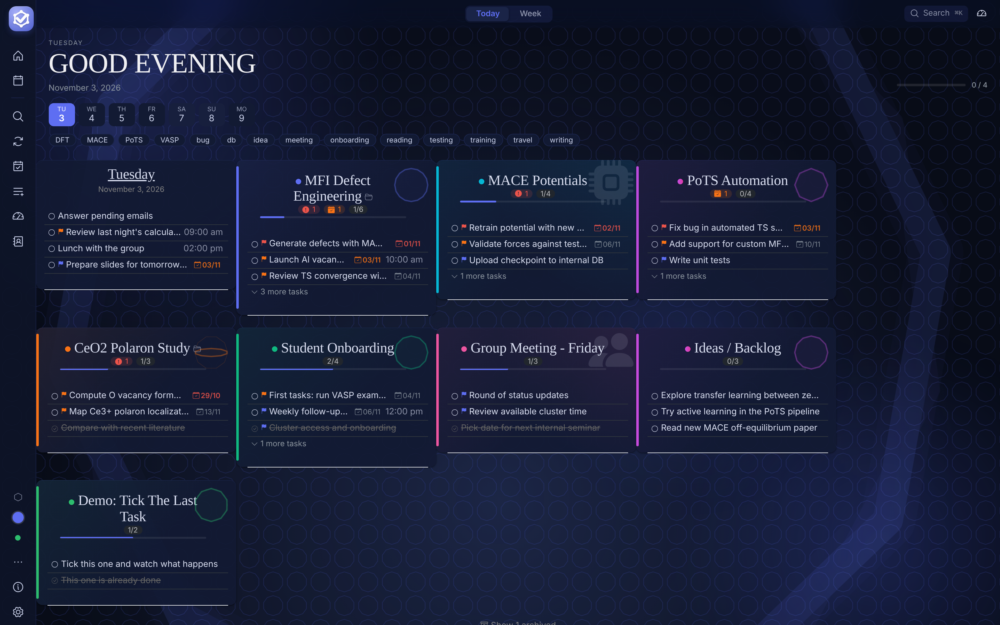

**Contenido:** [Instalación](#instalación) ·
[Primeros pasos](#primeros-pasos) ·
[Día a día](#el-día-a-día) ·
[Proyectos](#proyectos) ·
[Vista del curso](#vista-del-curso-planificación-a-largo-plazo) ·
[Deadlines](#deadlines-y-radar-de-urgencia) ·
[Resúmenes](#resúmenes-y-cierre-semanal) ·
[Personalización](#personalización) ·
[Datos](#dónde-viven-tus-datos) ·
[Atajos](#atajos-de-teclado)

---

## Instalación

Descarga el instalador para tu sistema desde la página de releases:

**[Descargar la última versión →](https://github.com/pafervi/ITQ-Todo/releases/latest)**

En esa página verás varios ficheros. Elige el que corresponda a tu sistema:

### Windows

Baja `LatticeTodo Setup <versión>.exe` y haz doble click.

> La primera vez Windows mostrará "Windows protegió el equipo". Pulsa
> **Más información → Ejecutar de todas formas**. Es porque la app no está
> firmada con un certificado corporativo, no porque haya nada raro.

Si prefieres la versión portable (no instala nada, se abre desde el fichero),
baja `LatticeTodo <versión>.exe` en lugar del Setup.

### Linux (Ubuntu / Debian / derivados)

Baja `latticetodo_<versión>_amd64.deb` y abre un terminal donde esté el fichero:

```bash
sudo apt install ./latticetodo_<versión>_amd64.deb
```

Aparecerá en el menú de aplicaciones como "LatticeTodo".

### Linux (otras distros, portable)

Baja `LatticeTodo-<versión>.AppImage`, dale permiso de ejecución y lánzala:

```bash
chmod +x LatticeTodo-*.AppImage
./LatticeTodo-*.AppImage
```

### macOS

Baja `LatticeTodo-<versión>.dmg`, ábrelo y arrastra la app a la carpeta
Aplicaciones.

> La primera vez macOS dirá "no se puede abrir porque el desarrollador no
> está identificado". Haz click derecho sobre la app en Aplicaciones y
> elige **Abrir → Abrir**. Solo pasa la primera vez.

---

## Primeros pasos

Al abrir por primera vez, la app crea una base de datos vacía en tu
ordenador. Los datos nunca salen de aquí; si cambias de equipo tienes que
**exportar y re-importar** desde Ajustes (ver
[Exportar e importar](#exportar-e-importar)).

Tres cosas que conviene hacer el primer día:

1. **Elegir idioma y tema** en Ajustes (inglés, castellano o catalán; claro u
   oscuro, y un tema científico para los fondos).
2. **Activar la copia de seguridad diaria**: elige una carpeta sincronizada
   con la nube (OneDrive, Google Drive, Dropbox) y la app guardará una copia
   cada día.
3. **Crear tu primer proyecto**, como checklist o por fases (ver
   [Proyectos](#proyectos)).

Dentro de la app, pulsa **?** en cualquier momento para ver los atajos de
teclado. La guía de funciones está en el menú de tres puntos de la barra
lateral.

---

## Qué puedes hacer con la app

### El día a día

La pantalla principal muestra Hoy y los proyectos activos a la vez. Las
tareas sin terminar de días anteriores pasan solas a Hoy cuando abres la
app o cuando el reloj cruza medianoche con la app abierta. La franja
superior deja saltar a cualquier día de la semana con un clic, o cambiar
entre vista **Today** (solo el día centrado) y **Week** (siete días en
columna).

Para crear una tarea rápida pulsas **N** desde cualquier sitio, tecleas
el texto y Enter. Si pegas texto multilínea, se crea una tarea por
línea. Con **doble clic** en el círculo de estado de una tarea entras en
modo foco: una sola tarea en pantalla, cronómetro simple, `Esc` para
salir.

**Captura global.** Con la app de escritorio, `Ctrl+Alt+Space` (o
`Cmd+Alt+Space` en macOS) abre una ventana mínima para apuntar una tarea
desde cualquier programa, sin cambiar de ventana.

Las tareas se etiquetan solas: si escribes VASP, MACE, DFT, SLURM o el
nombre de una zeolita, la app añade el tag correspondiente (se desactiva
en Ajustes). Una barra de tags permite filtrar las tareas por etiqueta y
volver a verlas todas con un clic.

**Tareas recurrentes.** Desde la barra lateral puedes definir tareas que
se repiten (reuniones de grupo, revisiones semanales…) y aparecen solas en
su día.

**App de escritorio.** Se queda en la bandeja del sistema, puede abrirse al
iniciar el ordenador y seguir en segundo plano, y avisa al arrancar de lo
que toca hoy, con sonido opcional.

### Proyectos

Cada proyecto es su propia lista, con nombre, color, una carpeta
enlazada (que abres con un clic en el icono de carpeta), notas en
Markdown y la zeolita (framework) asociada. Al crearlo eliges el tipo:

- **Checklist**: proyecto clásico, con tareas que se tachan.
- **Por fases**: proyecto científico con fecha de inicio y fin, dividido en
  fases a lo largo del tiempo.

Pulsa el título de un proyecto y se abre su **cristal**: estadísticas,
próxima fecha límite y tareas abiertas.

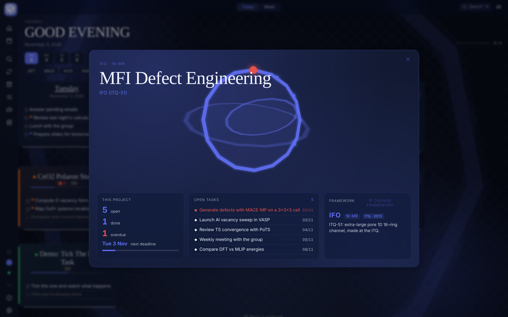

#### Proyectos por fases

Un proyecto por fases tiene tres pestañas: **Tareas**, **Timeline** y
**Feed**.

- **Timeline**: fases con nombre, fechas, color y estado (pendiente,
  activa, hecha, bloqueada). Por ejemplo, *Benchmark DFT → MACE L1 →
  Búsqueda de TS*.
- **Feed**: el diario del proyecto. Cada entrada es una nota, un hito o una
  decisión, con fecha y fase opcional.
- **Instantáneas semanales**: los lunes al abrir y los viernes al cerrar, la
  app te pregunta por cada proyecto por fases cómo está y qué se mueve (o
  qué se cerró y qué queda), y lo guarda como entrada del feed. Se puede
  saltar.
- **Exportar a Markdown**: desde el menú del proyecto, *Export timeline and
  log (.md)* genera un fichero con las fases y el feed, listo para pegar en
  un informe o dárselo como contexto a un asistente.

#### Herramientas de proyecto

Se activan desde el menú de tres puntos del proyecto:

- **Paper tracker**: seguimiento de un manuscrito por secciones, con palabras
  escritas y objetivo, borrador conceptual con casillas y plantillas de
  artículo. En escritorio puede leer el `.tex` o `.md` de la carpeta
  enlazada para actualizar el recuento. La cabecera del proyecto muestra el
  porcentaje.
- **Batch tracker**: una tanda larga de cálculos (por ejemplo 60 singlepoints)
  se sigue como una sola tarea, con barra de progreso y botones
  `-10 / -1 / +1 / +10`. Nunca por cálculo individual.

Además, puedes crear **plantillas propias** de lista (viaje, reunión, cierre
de paper…) con nombre, icono, color y checklist, y reutilizarlas al crear
proyectos nuevos.

### Vista del curso: planificación a largo plazo

El botón **Vista global** de la barra lateral abre la **vista del curso
académico** (septiembre a agosto), una pizarra por carriles para ver de
golpe todo lo que viene.

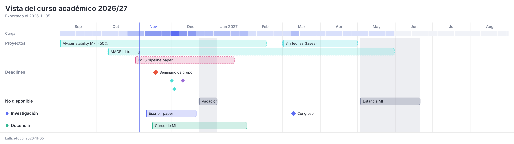

Qué contiene:

- **Proyectos** con fecha de inicio y fin, dibujados como barras. Si un
  proyecto tiene paper tracker, el porcentaje aparece en su barra.
- **Deadlines** de todas las tareas, con los de paper en morado y la próxima
  charla en rojo. Se abren y editan desde la propia vista.
- **Carriles propios** (investigación, docencia, lo que necesites) con
  bloques y hitos. Haz clic en un hueco para añadir, arrastra para mover
  (también a otro carril) y tira de los bordes para cambiar la duración.
- **No disponible**: vacaciones, festivos, épocas de docencia o exámenes y
  estancias, pintados como bandas grises de fondo.
- **Fases** de los proyectos por fases, que se pueden mostrar u ocultar.
- **Ideas sin fecha**: un panel lateral para apuntar cosas sin colocarlas
  todavía. Arrástralas a un carril para darles fecha.
- **Carga por semana**: una franja de color bajo los meses que indica cuántas
  cosas coinciden cada semana; al pasar el ratón, cuáles son.
- **Próximos 30 días**: lista con lo más cercano y la semana más cargada.
  La misma lista aparece en el Cierre del viernes y en el resumen semanal.

Para enseñar el plan, los botones de exportar de la cabecera generan una **imagen PNG** o un
**PDF** en A4 apaisado, siempre en tema claro. También exporta un `.md`
pensado como contexto para un asistente de IA.

### Deadlines y radar de urgencia

Cada tarea puede tener una fecha límite. La lista de **Deadlines**
agrupa todas las pendientes por urgencia (vencidas, hoy, pronto, más
tarde) con el proyecto de origen a la vista.

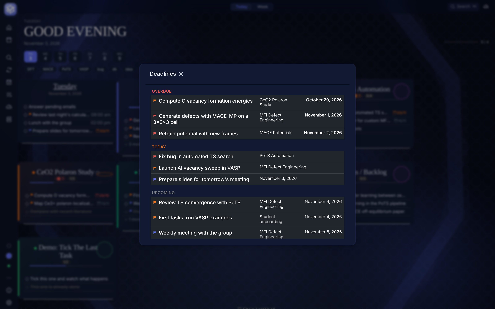

Para una vista espacial del mismo material, el **radar de vencimientos**
coloca cada deadline como un punto en anillos concéntricos: más cerca del
centro, más urgente. Las fechas de papers se pintan en color distinto;
si has configurado una charla próxima, se destaca en rojo y la barra
lateral muestra la cuenta atrás.

### Mission control

Un tablero bento con todo lo que importa a la vez: tareas de hoy,
próximas fechas límite (7 días), reuniones activas y un mapa de calor de
tu actividad en las últimas 12 semanas.

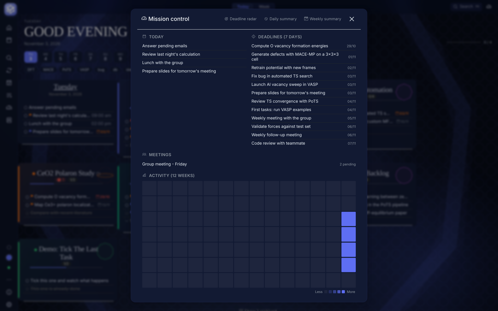

### Gente: quién te espera y a quién esperas

Si escribes `@nombre` dentro de una tarea, esa persona aparece en el
panel de **Gente**, con tres columnas: a quién le debes algo, quién te
espera a ti, y qué compartís. Los tags `#waiting` y `#owe` ajustan
quién va a qué columna. No hay que configurar nada: las menciones se
leen al momento, y el mismo nombre con o sin acentos y mayúsculas se
agrupa en una sola persona.

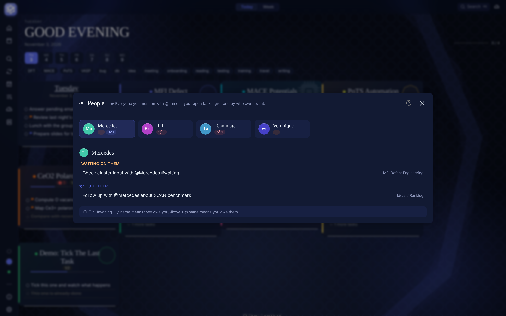

### Caja rápida: buscar y ejecutar

Pulsa **Ctrl+K** (o **/**) desde cualquier parte: te abre una caja que
busca tareas en todos los proyectos y, con el prefijo `>`, ejecuta
comandos (ir a Mission control, abrir Deadlines, cambiar tema, cambiar
vista, abrir el resumen diario o semanal…). Con el prefijo `+` crea una
tarea al vuelo entendiendo fecha (`tomorrow 10am`), tag (`#dft`),
prioridad (`!1`, `!2`, `!3`) y proyecto (`/ceo2`).

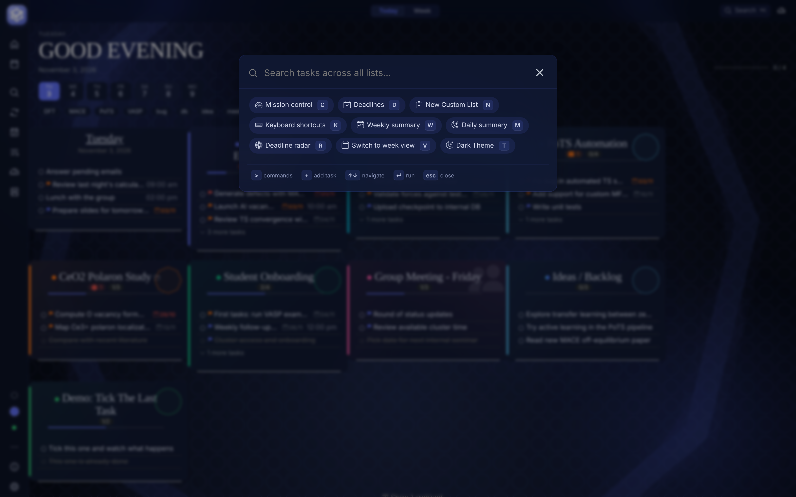

### Resúmenes y cierre semanal

A partir de las 17:00 la app te ofrece el **resumen del día** (lo que
has cerrado y lo que toca mañana). Los viernes a partir de las 17:00 se
abre el **Cierre del viernes**: lo que acabaste, lo que arrastras al
lunes, los próximos 30 días y tres preguntas cortas para dejar la semana
ordenada. Se puede exportar a Markdown. En la sidebar se lleva la cuenta
de la **racha** de días completos al 100%.

El **resumen semanal** agrupa lo completado por proyecto y por día, y
tiene el mismo bloque de próximas semanas. Desde ahí se exporta el
**cuaderno de laboratorio**, semanal o mensual, en una vista imprimible
con espacio para firma (*PDF / Print*); la versión mensual lleva portada.

### Identidad científica

Cada día la app elige un motivo del tema activo. La silueta pinta el
fondo del splash y la carátula de los proyectos. Puedes clicar la
insignia de la sidebar para abrir la ficha; en el tema de zeolitas indica
el tamaño del anillo mayor del framework y si fue descubierta en el ITQ.

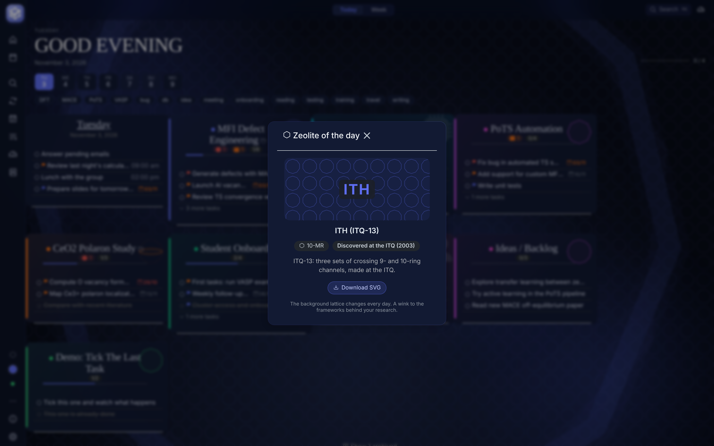

Hay cinco temas científicos, cada uno con sus propias siluetas del día:
**zeolitas**, **química orgánica**, **óxidos metálicos**, **fotoquímica**
y **proteínas**. Se cambian desde Ajustes → Display, y la app sugiere un
color de acento para cada uno.

### Personalización

Desde Ajustes puedes cambiar idioma (inglés / castellano / catalán),
tema claro u oscuro, tema científico, densidad (aireada o densa),
tipografía, color de acento, zoom, número de columnas, tarjetas de
proyecto compactas y su ancho, y si la semana empieza en lunes. Hay un
**modo rendimiento** que desactiva los fondos difuminados si tu equipo rinde
justo con la GPU integrada.

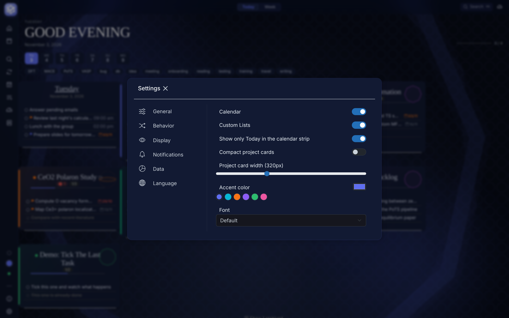

### Dónde viven tus datos

Todo se guarda localmente, en la base de datos IndexedDB del navegador
embebido. Nada se envía a ningún servidor.

#### Exportar e importar

Para pasar tus datos a otro equipo, o para guardarlos a mano:

1. **Exportar**: Ajustes → Datos → **Exportar datos**. Se descarga el fichero
   `LatticeTodoBackup.wtdb` con tareas, proyectos, fases, feed, vista global,
   tareas recurrentes y ajustes.
2. **Importar**: en el otro equipo, Ajustes → Datos → **Importar datos** y
   elige el `.wtdb`.

> Importar **sustituye** todos los datos actuales por los del fichero. Si el
> fichero no es válido, la app avisa y no toca nada.

En Ajustes → Datos también está **Borrar datos**, que vacía la app por
completo y no se puede deshacer.

#### Copia de seguridad automática

Con la app de escritorio puedes activar una copia diaria en una carpeta que
elijas, por ejemplo una sincronizada con OneDrive. Genera ficheros
`LatticeTodoBackup-AAAA-MM-DD.wtdb`, con el mismo contenido que una
exportación manual. Hay también un botón para hacer la copia en el momento
y una opción para **cargar la copia más reciente al abrir la app**, útil si
trabajas en dos ordenadores con la misma carpeta sincronizada.

#### Exportar para informes

El menú de tres puntos de la barra lateral incluye **Exportar todos los
proyectos**, un resumen en Markdown de todos tus proyectos. Cada proyecto
por fases, la vista global y los resúmenes semanales tienen además su propia
exportación.

### Guía dentro de la app

Si quieres ver todo lo anterior con ejemplos y pasos concretos, la
**Guía de funciones** está dentro de la app (sidebar → tres puntos →
Feature guide). Tiene una pestaña por cada bloque, con ejemplos reales
de uso.

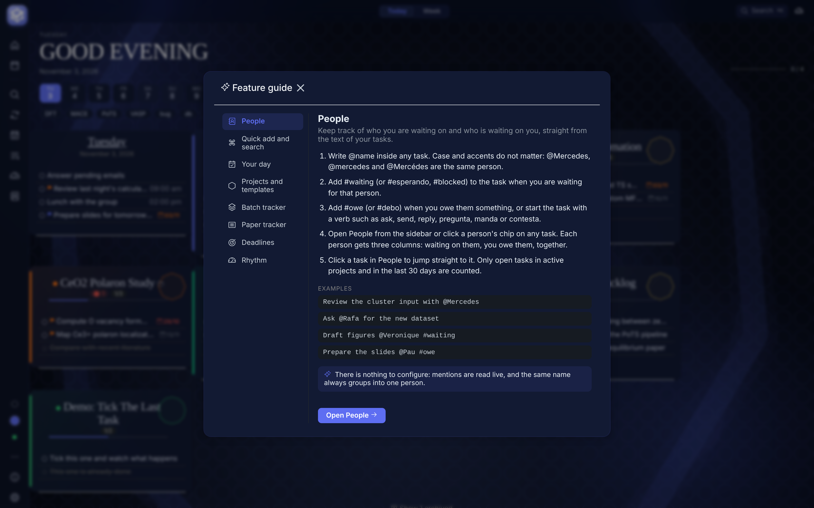

---

## Atajos de teclado

Los esenciales (los puedes ver en cualquier momento pulsando **?**):

| Tecla | Acción |
|---|---|
| `N` | Enfoca el campo de nueva tarea del día centrado |
| `T` | Vuelve a Hoy |
| `← / →` | Mueve un día atrás / adelante |
| `/` | Abre la búsqueda |
| `Ctrl+K` | Abre la caja rápida de comandos |
| `D` | Abre deadlines |
| `?` | Muestra esta ayuda |
| `Esc` | Cierra el diálogo abierto, o la vista del curso |
| `Ctrl+Alt+Space` | Captura global de una tarea (app de escritorio) |

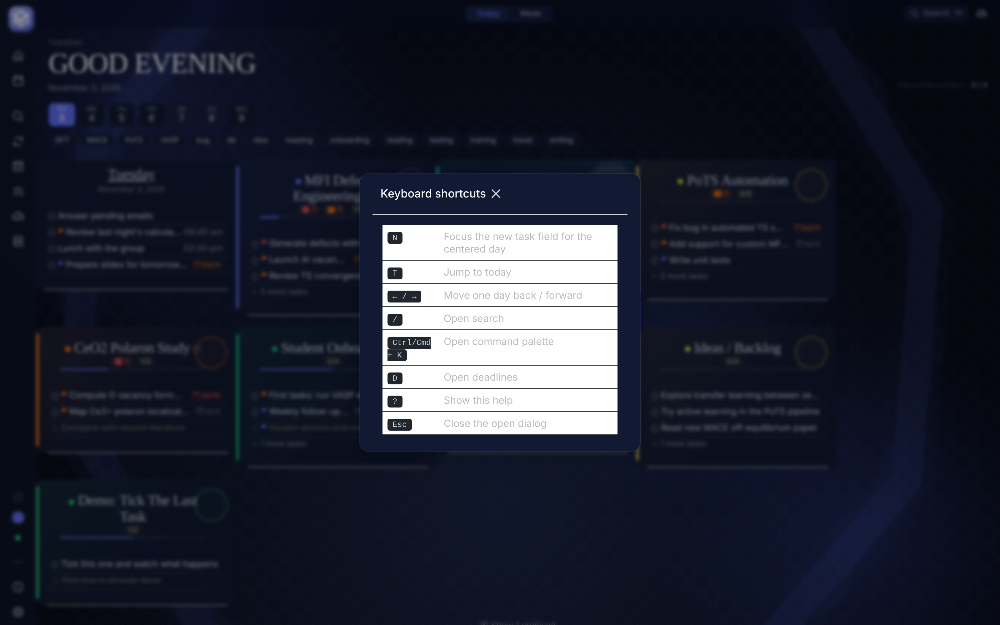

---

## Problemas y sugerencias

Abre un issue en el repositorio o escríbeme directamente.

## Licencia

GPL-3.0. Basado en [WeekToDo](https://github.com/manuelernestog/weektodo)
de Manuel Ernesto García, ampliado para flujo diario de investigación.
